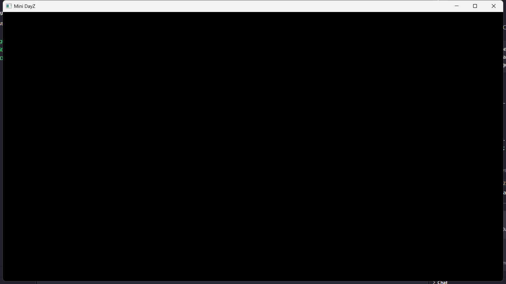
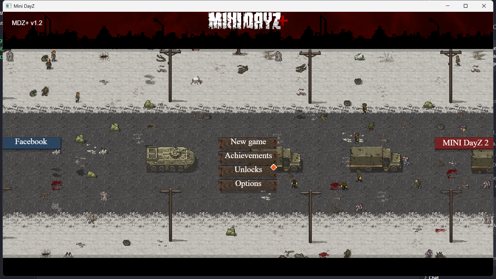

# MiniDayZ PC Port: Histórico de Evolução

Documento de acompanhamento da evolução técnica do port de MiniDayZ para PC (WPF + .NET 8 + WebView2).

---

## 📌 Linha do Tempo e Versões

| Versão | Data | Marco / Objetivo | Status |
|---|---|---|---|
| **v0.1.0** | 30/10/2026 | **Ponto Zero:** Scaffolding WPF/.NET 8, importação do motor HTML5 (MDZ+ 1.2), otimizações agressivas do WebView2, contorno de CORS via host virtual, UI anti-browser e primeiro teste IPC. | Concluído ✅ |
| **v0.2.0** | 30/10/2026 | **Evolução de Saves (Prioridade 2):** Backend nativo `SaveSystem.cs` (%LOCALAPPDATA%), gravação atômica, hidratação de boot assíncrona/síncrona, monkey patch de `localStorage` e IPC bidirecional. | Concluído ✅ |

---

## 🏗️ Estrutura Atual do Repositório

```
MINI_DAYA_Z/
├── .gitignore                  # Regras para .NET, VS, bin/obj e perfis do WebView2
├── README.md                   # Documentação geral de compilação e execução
├── EVOLUCAO.md                 # Histórico completo de evolução técnica do projeto
├── MiniDayZ.App.sln            # Solução C# do projeto
├── docs/
│   └── screenshots/            # Evidências visuais de execução e diagnósticos
│       ├── file_protocol_tela_preta.png   # Diagnóstico do CORS em file://
│       └── host_virtual_menu.png          # Menu inicial carregado com sucesso
└── src/MiniDayZ.App/
    ├── MiniDayZ.App.csproj     # Configuração do build .NET 8, GC econômico e cópia de assets
    ├── App.xaml / App.xaml.cs  # Ponto de entrada WPF
    ├── AssemblyInfo.cs         # Metadados e ThemeInfo
    ├── SaveSystem.cs           # Persistência atômica (.json em %LOCALAPPDATA%\MiniDayZ\Saves)
    ├── MainWindow.xaml         # Janela com Grid zerado e host WebView2 em tela cheia
    ├── MainWindow.xaml.cs      # Host Chromium otimizado, IPC de saves e DevTools logging
    └── wwwroot/                # MiniDayZ Plus 1.2 (1.876 arquivos, ~27 MB)
        ├── index.html          # HTML modificado com CSS nativo e monkey patch de saves
        ├── c2runtime.js        # Engine Construct 2
        ├── data.js             # Lógica e definições do jogo
        ├── images/             # Texturas e spritesheets
        └── media/              # Efeitos sonoros e trilha sonora
```

---

## 🎯 Marco 1: Ponto Zero (v0.1.0)

O objetivo do Ponto Zero foi criar a fundação mais leve possível para executar o MiniDayZ como um aplicativo nativo do Windows, visando viabilizar desempenho fluido em processadores híbridos (Intel Lakefield) e CPUs modestas (Core i3 com 8 GB de RAM).

### Etapa 1: Estruturação do Projeto (Git e .NET 8)
- **Repositório Git:** Inicializado localmente.
- **`.gitignore` Otimizado:** Exclusão de pastas de compilação (`bin/`, `obj/`, `publish/`), metadados do Visual Studio (`.vs/`, `*.user`, `*.suo`), pacotes NuGet e o diretório de dados em tempo de execução do WebView2 (`*.WebView2/`, `WebView2Data/`).
- **`README.md`:** Documento inicial do projeto descrevendo a arquitetura "MiniDayZ PC Port - Wrapper WPF + WebView2".
- **Solução e Projeto WPF:** Criação da solução `MiniDayZ.App.sln` e do projeto `src/MiniDayZ.App/MiniDayZ.App.csproj` alvejando `net8.0-windows`.
- **Tuning de Baixo Consumo no `.csproj`:**
  - `ServerGarbageCollector=false` e `ConcurrentGarbageCollection=false`: Garante GC de estação de trabalho sem threads adicionais consumindo CPU em segundo plano.
  - `TieredPGO=true`: Otimização orientada a perfil do JIT para reduzir overhead de CPU.
  - `InvariantGlobalization=true` e `SatelliteResourceLanguages=en`: Remove tabelas pesadas de globalização e satélites de idiomas desnecessários da memória RAM.

### Etapa 2: Importação do Motor Web (`wwwroot`)
- **Download do Código-Fonte:** Clone do repositório upstream `https://github.com/NextDev65/MiniDayZ.git`.
- **Seleção de Versão:** O repositório continha três versões (`docs/` [Plus 1.2], `original_docs/` [Original 1.4.1] e `reloaded_docs/` [Reloaded 1.1]). Foi selecionada a pasta `docs/`, correspondente à versão **Plus 1.2** (a mais recente, com suporte aprimorado a mouse/PC).
- **Importação:** Extração completa de 1.876 arquivos para a pasta `src/MiniDayZ.App/wwwroot/`.
- **Automação no `.csproj`:**
  ```xml
  <ItemGroup>
    <Content Include="wwwroot\**\*">
      <CopyToOutputDirectory>PreserveNewest</CopyToOutputDirectory>
    </Content>
  </ItemGroup>
  ```
  Isso garante que todos os arquivos do jogo sejam copiados para a pasta de saída do binário sem necessidade de intervenção manual.

### Etapa 3: Otimização Agressiva do WebView2 (C#)
- **Dependência:** Instalação do pacote NuGet oficial `Microsoft.Web.WebView2` (versão `1.0.4314.35`).
- **Interface XAML:** No `MainWindow.xaml`, definição de Grid zerado (`Margin="0"`), fundo preto (`Background="Black"`) e o controle `WebView2` preenchendo 100% da área cliente. Não foi definido `Source` no XAML para impedir que o WPF iniciasse um ambiente padrão do Chromium antes das nossas flags serem aplicadas.
- **Tuning do Chromium (`InitializeAsync` em `MainWindow.xaml.cs`):**
  Criação do ambiente via `CoreWebView2EnvironmentOptions` injetando flags críticas:
  - `--disable-features=Translate,OptimizationHints,MediaRouter`: Elimina serviços em segundo plano, telemetria de otimização e descoberta de dispositivos na rede.
  - `--disable-background-networking`: Impede tráfego espúrio de rede do navegador.
  - `--disable-extensions`: Remove completamente o pipeline de extensões.
  - `--force-gpu-rasterization`: Força a GPU a processar texturas 2D, aliviando a CPU fraca.
  - `--enable-zero-copy`: Elimina cópias redundantes de memória de vídeo durante transferências de raster.
- **Isolamento de Dados:** Perfil do WebView2 redirecionado para `%LOCALAPPDATA%\MiniDayZ\WebView2` para não violar permissões de escrita em pastas como `Program Files`.
- **Desativação de Overheads de Navegador (`ConfigureSettings`):** Desabilitados menu de contexto nativo, barra de status, zoom/pinch/swipe, aceleradores de teclado de browser, preenchimento automático e páginas de erro integradas.

### Etapa 4: Ponte IPC Inicial e Descoberta/Solução do Bloqueio de CORS
- **Assinatura de Evento:** Configurado `core.WebMessageReceived += OnWebMessageReceived;` com saída para `Debug.WriteLine`.
- **Diagnóstico Crítico de CORS:** 
  Ao tentar navegar para o arquivo físico com `new Uri(indexPath).AbsoluteUri` (`file:///`), a tela ficava preta. Ao capturar os logs internos do Chromium via CDP (Chrome DevTools Protocol), identificou-se o erro:
  `Access to XMLHttpRequest at 'file:///.../data.js' from origin 'null' has been blocked by CORS policy`
  O motor Construct 2 carrega o arquivo `data.js` e áudios via `XMLHttpRequest`, o que os navegadores modernos bloqueiam sob o protocolo `file://`.
- **Solução Arquitetural:** 
  Mapeamento de diretório para host virtual local:
  ```csharp
  core.SetVirtualHostNameToFolderMapping(
      "minidayz.example",
      Path.GetDirectoryName(indexPath)!,
      CoreWebView2HostResourceAccessKind.DenyCors);
  core.Navigate("https://minidayz.example/index.html");
  ```
  A resolução é 100% local (sem servidor HTTP ativo, sem portas abertas e sem rede).

### Etapa 5: Limpeza de Interface Nativa (HTML/CSS)
- **Remoção de Estilo de Navegador:** Injeção no `<head>` do `wwwroot/index.html`:
  ```html
  <style>
    body, html { overflow: hidden; user-select: none; -webkit-user-drag: none; touch-action: none; }
    img { pointer-events: none; }
  </style>
  ```
- **Bloqueio de Menu e Teste Inicial:** Injeção de script bloqueando `contextmenu` e emitindo a mensagem IPC:
  ```html
  <script>
    document.addEventListener('contextmenu', event => event.preventDefault());
    window.addEventListener('load', () => {
       if (window.chrome && window.chrome.webview) {
           window.chrome.webview.postMessage("TestIPC_Success");
       }
    });
  </script>
  ```

### Etapa 6: Validação do Ponto Zero
- **Harness de Teste:** Criado utilitário de teste em C# conectado à fila `DBWIN_BUFFER` (mensagens do `OutputDebugString`).
- **Resultados:**
  - Recebimento confirmado da string `[MiniDayZ IPC] TestIPC_Success`.
  - Captura de screenshot confirmando renderização completa do menu inicial (`MDZ+ v1.2`).

| Teste | Com `file://` | Com Host Virtual (`https://minidayz.example/`) |
|---|---|---|
| Build Release | ✅ Sucesso | ✅ Sucesso |
| IPC `TestIPC_Success` | ✅ Recebido | ✅ Recebido |
| Renderização Visual | ❌ Tela preta (CORS bloqueando `data.js`) | ✅ **Menu Inicial Renderizado** |

````carousel

<!-- slide -->

````

---

## ⚡ Marco 2: Sistema de Saves via IPC (v0.2.0)

Na versão **v0.2.0**, o objetivo foi garantir persistência nativa e robusta dos dados do jogador, isolando o progresso do jogo do ciclo de vida volátil do navegador ou de limpezas de cache do WebView2.

### 1. Backend Nativo em C# (`SaveSystem.cs`)
- **Localização dos Saves:** Armazenados como arquivos `.json` individuais em `%LOCALAPPDATA%\MiniDayZ\Saves\[key].json`.
- **Gravação Atômica:** O arquivo é primeiro escrito como `.tmp` e então substituído (`File.Move` com `overwrite: true`), impedindo saves corrompidos caso o jogo seja fechado durante a escrita.
- **Sanitização de Chaves:** Uso de `Uri.EscapeDataString(key)` para impedir Path Traversal e evitar caracteres inválidos no sistema de arquivos do Windows.
- **Operações:** `Save(key, data)`, `Load(key)`, `Delete(key)`, `LoadAll()`.

### 2. Ponte IPC e Hidratação Prévia (`MainWindow.xaml.cs`)
- **O Desafio da Concorrência:** `localStorage.getItem()` do JavaScript é síncrono. No entanto, a comunicação IPC entre WebView2 e C# é assíncrona. Se o jogo solicitar um save durante sua inicialização, ele não pode aguardar uma resposta assíncrona do C#.
- **Solução Arquitetural (Hidratação no Boot):**
  Antes de carregar o DOM ou executar qualquer script da página, o C# faz uma leitura completa dos saves existentes no disco e injeta o dicionário diretamente no contexto global da página via `AddScriptToExecuteOnDocumentCreatedAsync`:
  ```csharp
  string savesJson = JsonSerializer.Serialize(SaveSystem.LoadAll());
  await core.AddScriptToExecuteOnDocumentCreatedAsync($"window.__MDZ_SAVES__ = {savesJson};");
  ```
  Assim, no instante zero da execução do JavaScript, todos os dados salvos já estão disponíveis na memória local.
- **Tratamento no `OnWebMessageReceived`:**
  - `action == "save"`: Chama `SaveSystem.Save(key, data)`.
  - `action == "load"`: Chama `SaveSystem.Load(key)` e dispara o evento assíncrono `SaveLoaded` de volta para o JS (`window.dispatchEvent(new CustomEvent('SaveLoaded', { detail: { key, data } }))`).
  - `action == "delete"`: Chama `SaveSystem.Delete(key)`.

### 3. Intercepção JavaScript (Monkey Patch no `index.html`)
- Injetado no topo do `<head>` do `index.html` antes do carregamento do motor Construct 2.
- Sobrescrita de `Storage.prototype`:
  - `setItem(k, v)`: Atualiza o cache em memória e dispara mensagem IPC assíncrona `{ action: 'save', key: k, data: v }`.
  - `getItem(k)`: Retorna imediatamente da memória/disco hidratado de forma síncrona.
  - `removeItem(k)` / `clear()`: Deleta dados locais e emite mensagens `{ action: 'delete', key: k }` para o host C#.
- **Recuperação Automática:** Se o perfil do WebView2 for limpo ou corrompido, o script restaura automaticamente no `localStorage` nativo tudo o que estiver persistido no disco.
- **API Adicional:** Exposição da interface `window.MDZSaves.load(key)` baseada em Promises.

---

## 🚀 Como Executar o Projeto

```powershell
# Compilar a solução em Release
dotnet build MiniDayZ.App.sln -c Release

# Executar a aplicação WPF
dotnet run --project src/MiniDayZ.App
```

No Visual Studio:
1. Abra `MiniDayZ.App.sln`.
2. Pressione **F5** (Debug) ou **Ctrl+F5** (Release).
3. Na janela **Output** (Depurar), visualize os logs do IPC (`[MiniDayZ IPC] TestIPC_Success`, saves efetuados e logs de console do motor web).

---

## 📋 Próximos Passos Sugeridos

- [ ] Implementar modo exclusivo de tela cheia com alternância via tecla `F11`.
- [ ] Configurar suspensão de renderização e redução de memória (`MemoryUsageTargetLevel = Low`) quando a janela for minimizada.
- [ ] Criar gerenciador visual de perfis de save na interface WPF nativa.
- [ ] Publicação do pacote como executável autocontido (*Single-File Publish*).

