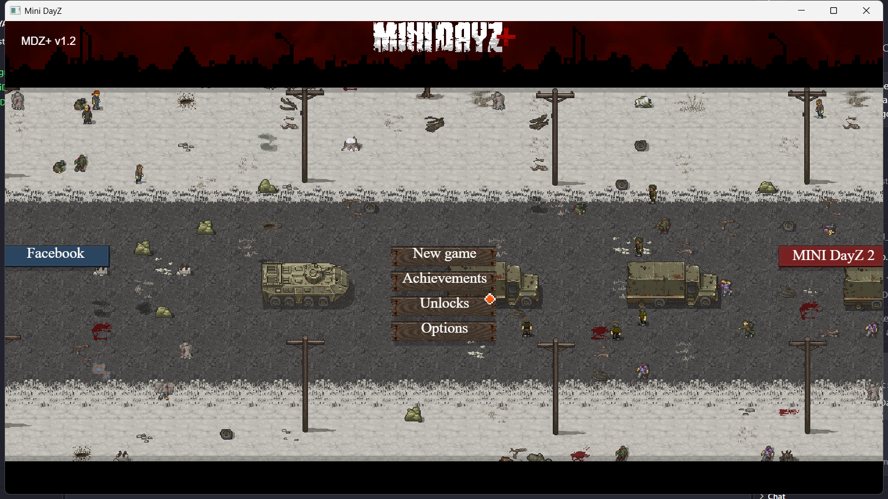
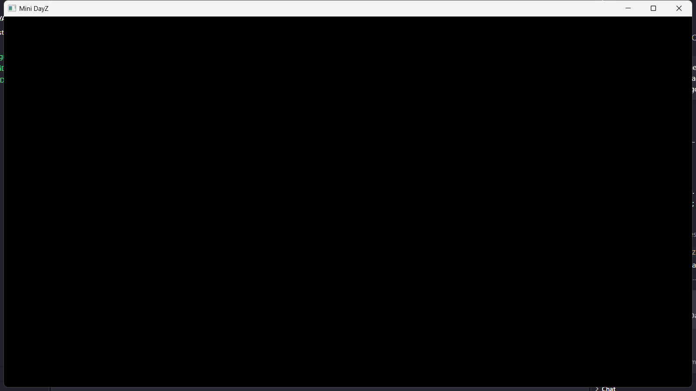

# MiniDayZ PC Port: Relatório de Evolução (v0.2.0)

**Versão:** `v0.2.0` · **Data:** 30/10/2026 · **Commits:** `67050b0` (v0.1.0) → `649054d` (v0.2.0) · **Stack:** WPF / .NET 8 + Microsoft Edge WebView2

## Resumo

- Criei um wrapper nativo para Windows que roda o MiniDayZ (HTML5, Construct 2) dentro de um WebView2 com o Chromium enxuto.
- **Resultado:** o build passa em Debug e Release sem erros nem avisos. A janela abre e mostra o menu inicial do jogo, e a mensagem `TestIPC_Success` chega ao C#.



---

## Estrutura final

```
MINI_DAYA_Z/
├── .gitignore                  # .NET / VS / cache do WebView2
├── README.md
├── PONTO_ZERO_RELATORIO.md
├── MiniDayZ.App.sln
└── src/MiniDayZ.App/
    ├── MiniDayZ.App.csproj     # net8.0-windows, WPF, WebView2, regra do wwwroot
    ├── SaveSystem.cs           # Backend de persistência atômica (.json em %LOCALAPPDATA%\MiniDayZ\Saves)
    ├── App.xaml / App.xaml.cs
    ├── AssemblyInfo.cs
    ├── MainWindow.xaml         # Grid zerado + WebView2 em tela cheia
    ├── MainWindow.xaml.cs      # InitializeAsync, flags do Chromium, IPC & Saves
    └── wwwroot/                # MiniDayZ Plus 1.2 (1876 arquivos, cerca de 27 MB)
```

---

## Etapa 1: estrutura do projeto

| Item | Status | Observação |
|---|---|---|
| `git init` | ✅ | Repositório local criado |
| `.gitignore` | ✅ | Ignora `bin/`, `obj/`, `.vs/`, `*.user`, pacotes NuGet e o perfil `*.WebView2/` |
| `README.md` | ✅ | "MiniDayZ PC Port - Wrapper WPF + WebView2" |
| Solução `MiniDayZ.App` (WPF, .NET 8) | ✅ | Arquivos escritos à mão porque o ambiente bloqueou o cache de templates do `dotnet new`. O resultado é o mesmo. |

> [!NOTE]
> A máquina tem só o SDK .NET 10, que compila `net8.0-windows` sem problema. O Desktop Runtime 8.0.32 está instalado para rodar o app.

## Etapa 2: motor web (wwwroot)

- **Origem:** clone de `https://github.com/NextDev65/MiniDayZ.git`.
- **Versões disponíveis:** o repositório traz três builds:
  - `docs/`: **Plus 1.2**, a versão atual publicada no GitHub Pages. ← **escolhida**
  - `original_docs/`: Original 1.4.1 da Bohemia.
  - `reloaded_docs/`: mod Reloaded 1.1.
- **Formato dos arquivos:** o jogo exportado pelo Construct 2 não tem as pastas `js/css/assets`. Os arquivos ficam soltos na raiz: `index.html`, `c2runtime.js`, `data.js`, `images/`, `media/` e os XMLs de idioma.
- **Cópia:** os 1876 arquivos foram copiados e conferidos contra a origem. O clone temporário foi apagado depois.
- **Regra no `.csproj`:**

```xml
<ItemGroup>
  <Content Include="wwwroot\**\*">
    <CopyToOutputDirectory>PreserveNewest</CopyToOutputDirectory>
  </Content>
</ItemGroup>
```

Conferido: `bin\Release\net8.0-windows\wwwroot\data.js` existe depois do build.

## Etapa 3: otimização do WebView2

- **Pacote:** `Microsoft.Web.WebView2` **1.0.4314.35**. O WebView2 Runtime instalado é o 156.0.4314.50.
- **XAML:** um `Grid` com `Margin="0"` e o WebView2 esticado nas duas direções, com fundo preto. **O `Source` não é definido no XAML**, porque isso criaria um ambiente padrão antes do otimizado.
- **`InitializeAsync()`:** cria o ambiente com `CoreWebView2EnvironmentOptions` e as flags abaixo.

```csharp
private const string BrowserArguments =
    "--disable-features=Translate,OptimizationHints,MediaRouter " +
    "--disable-background-networking " +
    "--disable-extensions " +
    "--force-gpu-rasterization " +
    "--enable-zero-copy";
```

**Ajustes além do pedido:**

| Ajuste | Motivo |
|---|---|
| Perfil em `%LOCALAPPDATA%\MiniDayZ\WebView2` | A pasta do executável pode não ser gravável (ex.: Program Files). É ali que ficam os saves em IndexedDB. |
| Menu de contexto, zoom, pinch, swipe, autofill, senhas, atalhos, barra de status e página de erro desligados | Tira a "cara de navegador" e corta trabalho de fundo |
| `AreHostObjectsAllowed = false` | Reduz a superfície de ataque |
| DevTools só em `DEBUG` | O Release sai mais enxuto |
| `.csproj`: GC no modo estação de trabalho, sem modo concorrente, `TieredPGO`, `InvariantGlobalization`, recursos de idioma só em `en` | Menos memória e threads no hardware-alvo (Lakefield / i3 com 8 GB) |
| Tratamento de `WebView2RuntimeNotFoundException` | Mostra uma mensagem clara se o runtime do WebView2 não estiver instalado |

## Etapa 4: ponte IPC

- `WebMessageReceived` assinado. O handler tenta ler a mensagem como texto com `TryGetWebMessageAsString()` e, se não der, usa `WebMessageAsJson`.
- O log sai como `Debug.WriteLine("[MiniDayZ IPC] ...")`.
- Só em DEBUG: o console, os erros de rede e as exceções do JS são repassados ao Output via CDP (`Log.entryAdded`, `Runtime.consoleAPICalled`, `Runtime.exceptionThrown`).

> [!IMPORTANT]
> **Mudança em relação ao pedido: o jogo é carregado por um host virtual, não por `file://`.**
>
> O runtime do Construct 2 carrega o `data.js` (e os áudios) por `XMLHttpRequest`. Em `file://` o Chromium bloqueia isso por CORS:
>
> `Access to XMLHttpRequest at 'file:///.../wwwroot/data.js' from origin 'null' has been blocked by CORS policy`
>
> **Resultado:** a tela ficava preta. A correção liga a **mesma pasta física** a um host HTTPS que só existe dentro do app, sem servidor e sem rede:
>
> ```csharp
> string indexPath = Path.Combine(AppDomain.CurrentDomain.BaseDirectory, "wwwroot", "index.html");
> core.SetVirtualHostNameToFolderMapping("minidayz.example",
>     Path.GetDirectoryName(indexPath)!, CoreWebView2HostResourceAccessKind.DenyCors);
> core.Navigate("https://minidayz.example/index.html");
> ```
>
> **Alternativa descartada:** `--allow-file-access-from-files` também resolveria, mas afrouxa a segurança do navegador. O TLD `.example` é reservado e nunca colide com um domínio real.

## Etapa 5: limpeza da interface (HTML/CSS)

- **No `<head>` do `wwwroot/index.html`:** coloquei o CSS (`overflow`, `user-select`, `-webkit-user-drag`, `touch-action`, `img { pointer-events: none }`) e o script.
- **O que o script faz:** bloqueia o menu de contexto e, no `load`, envia `TestIPC_Success` por `window.chrome.webview.postMessage`.
- **Escopo da edição:** só esse arquivo do jogo foi alterado.

---

## Etapa 7: Prioridade 2 - Sistema de Saves via IPC

Para desacoplar os saves do ciclo de vida volátil do navegador/WebView2 e permitir backup/gerenciamento nativo, implementamos uma persistência externa:

### 1. Backend C# (`SaveSystem.cs`)
- Salva arquivos individuais em `%LOCALAPPDATA%\MiniDayZ\Saves\[key].json`.
- Chave sanitizada (`Uri.EscapeDataString`) contra Path Traversal.
- Gravação atômica (`.tmp` → overwrite) para prevenir corrupção em quedas de energia.
- Métodos estáticos: `Save(key, data)`, `Load(key)`, `Delete(key)`, `LoadAll()`.

### 2. Ponte IPC e Hidratação Prévia (`MainWindow.xaml.cs`)
- **Problema de concorrência:** `localStorage.getItem()` do JavaScript é síncrono, mas IPC entre WebView2 e WPF é assíncrono.
- **Solução (Hidratação no Boot):** Antes da execução de qualquer script no documento, o C# executa:
  ```csharp
  await core.AddScriptToExecuteOnDocumentCreatedAsync($"window.__MDZ_SAVES__ = {savesJson};");
  ```
  Assim o dicionário de saves já existe na memória JS no milissegundo zero do carregamento.
- **Tratamento de Mensagens (`OnWebMessageReceived`):**
  - `action == "save"`: Chama `SaveSystem.Save(key, data)`.
  - `action == "load"`: Chama `SaveSystem.Load(key)` e dispara de volta para o JS o evento `SaveLoaded`:
    ```csharp
    window.dispatchEvent(new CustomEvent('SaveLoaded', { detail: { key, data } }));
    ```
  - `action == "delete"`: Chama `SaveSystem.Delete(key)`.

### 3. Intercepção JavaScript (Monkey Patch no `index.html`)
- Injetado no topo do `<head>` do `wwwroot/index.html` antes de qualquer dependência ou do Construct 2.
- Sobrescreve `Storage.prototype` (`setItem`, `getItem`, `removeItem`, `clear`).
- Restaura dados do disco no `localStorage` nativo se o perfil foi limpo.
- Expõe também a API assíncrona global `window.MDZSaves.load(key)`.

---

## Etapa 6: validação

Sem um Visual Studio anexado, a validação usou um programa de teste fora do repositório. Ele:
- lê as mensagens de `OutputDebugString`, o mesmo canal do Output do VS e do DebugView;
- abre o app e tira print da janela;
- mede a memória.

````carousel

<!-- slide -->

````

| Teste | `file://` | Host virtual |
|---|---|---|
| Build Debug / Release | ✅ 0 avisos, 0 erros | ✅ 0 avisos, 0 erros |
| `[MiniDayZ IPC] TestIPC_Success` | ✅ | ✅ |
| Menu do jogo renderizado | ❌ tela preta | ✅ |
| Service worker | n/a | ✅ registrado |
| IndexedDB (saves) | n/a | ✅ abre sem erro (fora do ambiente de teste restrito)¹ |

¹ Dentro do ambiente de teste restrito houve erro de IndexedDB, porque ele bloqueia gravação em `%LOCALAPPDATA%`. Não é um bug do app.

**Memória observada (aproximada):**
- **Processo do app:** cerca de 140 MB.
- **Processos `msedgewebview2`:** cerca de 310 MB com a tela preta e cerca de 1 GB com o jogo rodando.
- **Limite da medição:** esse total inclui outros processos WebView2 do sistema, então não mede só o jogo. É preciso medir com isolamento no hardware-alvo.

---

## Como rodar

```powershell
dotnet build MiniDayZ.App.sln -c Release
dotnet run --project src/MiniDayZ.App
```

No Visual Studio, aperte F5. `[MiniDayZ IPC] TestIPC_Success` aparece na janela **Output → Debug**.

## Próximos passos sugeridos

- [ ] Medir a memória isolando só a árvore de processos do app, no Lakefield e no i3.
- [ ] Usar `MemoryUsageTargetLevel = Low` quando a janela for minimizada.
- [ ] Ativar o modo tela cheia (`WindowStyle="None"` + maximizado), com F11 para alternar.
- [ ] Definir o protocolo de IPC (JSON tipado) para saves nativos, conquistas e configurações.
- [ ] Publicar como single-file, com o WebView2 Runtime Evergreen como pré-requisito.
